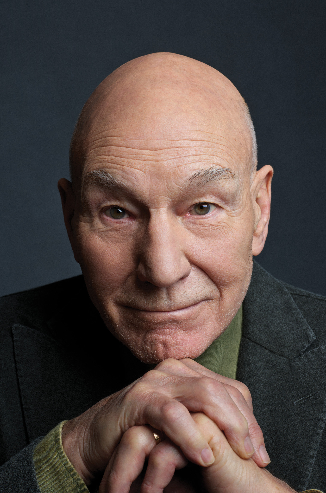

[Sir Patrick Stewart][2], best known for his role as Captain Jean-Luc Picard on Star Trek: The Next Generation, [has died at the age of 86][1]. He passed at home in Los Angeles from Alzheimer’s disease and Lewy body dementia.

This is hard news to take, even though Stewart lived a full and fulfilling life.

Anita Gates and William McDonald [writing for The New York Times][1]:

> For Mr. Stewart, acting was a compulsion, he said, something he was driven to do. In 2011, a BBC interviewer asked him to describe the experience of being onstage. Mr. Stewart answered, “It feels like being a giant.”
And he saw no reason to quit, even in his later years.
>
>>“Acting was the thing that made me happy when I was 13 years old,” he wrote in his memoir, “and that is still the case 70 years later. I have so much more work to do. I am not done with the stage. I still want to try another TV comedy. I still have so many characters inside me that I need to let out.”

[1]:https://archive.is/dC5KO
[2]:https://en.wikipedia.org/wiki/Patrick_Stewart
